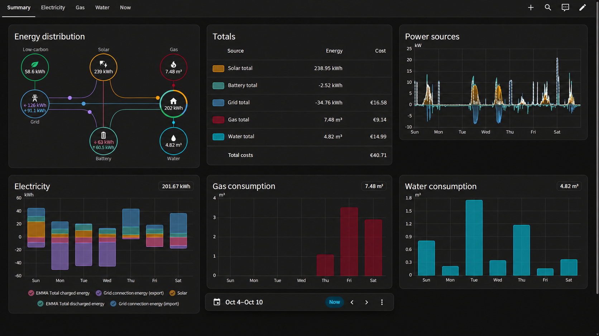
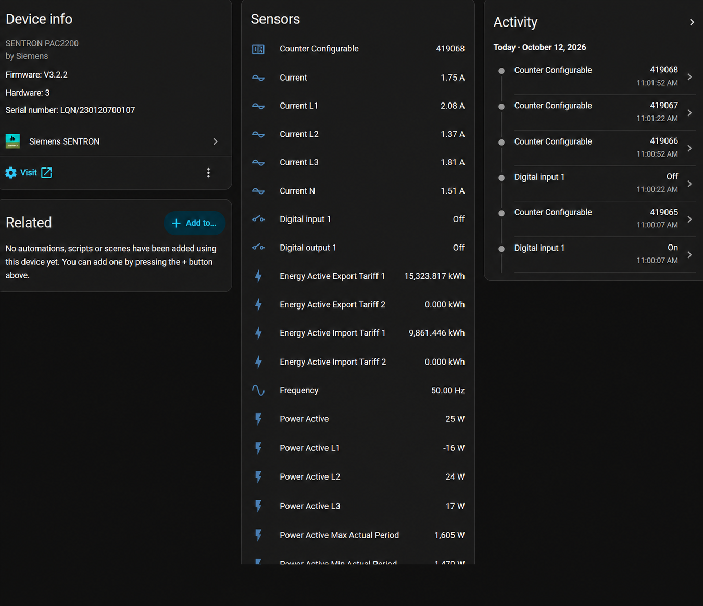
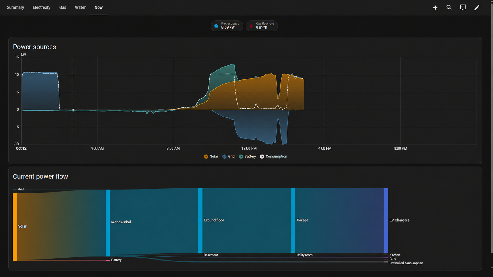

# Energy dashboard and reporting

[Back to the overview](../README.md)

## From measurements to useful answers

Which circuits use the most electricity? How does this week's consumption compare with last week? How much energy does EV charging account for? Use the integration's readings as inputs to Home Assistant's own dashboards, statistics and your reporting workflows.



The image is an example installation, not a dashboard shipped by the integration. Solar generation, battery readings, prices and other data may come from separate integrations or helpers.

## Choose the correct data

| What you want to show | Appropriate source |
| --- | --- |
| Electricity consumption and grid exchange | Cumulative active-energy import/export counters in kWh |
| Current power usage and appliance activity | Active-power measurements in W or kW |
| Gas consumption | A separately scaled pulse counter with `device_class: gas` |
| Water consumption | A separately scaled pulse counter with `device_class: water` |

For the PAC2200, choose the applicable collective import/export tariff counters. Include both tariff counters when both are used, or create a suitable sum; do not add that sum and its individual inputs to the same accounting total. Similarly, do not add phase totals and the collective total as separate consumption for the same circuit.

Select energy entities in the Energy dashboard's settings and add the appropriate live power entities where supported. Energy totals use a compatible unit and `total` or `total_increasing` statistics; live power uses `measurement`. Configure costs or tariffs separately. See the [Home Assistant energy FAQ](https://www.home-assistant.io/docs/energy/faq/) for the accepted sensor attributes and troubleshooting.

Reactive and apparent energy are different quantities, not substitutes for active electrical energy in kWh. For VersiCharge, use **Total charged energy** for cumulative consumption and **Charging power** for current usage.

## Gas or water through the PAC2200 universal counter

The integration exposes the PAC2200's **Counter Configurable** reading. In the software profile, this is a raw counter without a gas/water unit or statistics class. It is therefore **not directly a ready-to-use gas or water sensor**.



The intended measurement chain is:

**Compatible meter pulse output → PAC2200 digital input / universal counter → SENTRON counter entity → scaled Home Assistant gas or water sensor → Energy dashboard.**

A compatible pulse output and correctly commissioned counting input are required. Have installation and wiring checked by qualified personnel against the meter and PAC documentation. Do not infer a compatible electrical interface just because a meter has a pulse output. The PAC2200 has **one digital input and one configurable universal counter**, so it can count one independent external meter this way. Gas and water in the same installation need separate counting channels, for example separate PAC2200 devices. See the Siemens **PAC2200 Equipment Manual, L1V30415167B-06, sections 2.3.4 and 2.4**.

### Scale the count once

After verifying what one counter increment represents, calculate the consumed volume. For example, **one raw increment per 10 litres** gives:

```text
Water volume [m³] = raw counter × 0.01
```

For a meter specified in pulses per cubic metre:

```text
Volume [m³] = raw pulses ÷ pulses per m³
```

These are alternative expressions of the same conversion, not two steps to apply together. Check any scaling already configured in the device before adding a Home Assistant conversion. Add a fixed meter-reading offset only when needed and validated.

### Create the Home Assistant sensor

Use a Template helper or YAML template sensor with the scaled numeric total, a stable unique ID, `device_class: gas` or `device_class: water`, and an accepted volume unit such as `m³`. Choose the state class to match the actual counter/reset behaviour. Make the derived sensor unavailable when the source is not a valid number; **do not turn `unknown` or `unavailable` into zero**, as this can corrupt consumption statistics.

Check a known volume change against the physical meter before adding the derived total to the gas or water section. Validate counter resets, replacement and any rollover rather than silently treating every decrease as genuine consumption. [Home Assistant's sensor documentation](https://developers.home-assistant.io/docs/core/entity/sensor/) explains state classes and reset semantics; the [Template documentation](https://www.home-assistant.io/integrations/template/) explains availability templates.

## Put it together

Assign devices to meaningful areas, select the counters that match the physical measurement points, and build the desired floor/circuit hierarchy. Combine with separately configured solar and battery sources where available. The integration supplies supported device data; it does not discover pulse weights, utility prices, the building hierarchy or third-party energy sources automatically.



For more advanced exports and recurring reports, use your chosen Home Assistant reporting workflow or external tooling. No reporting scheduler is bundled with this integration.
