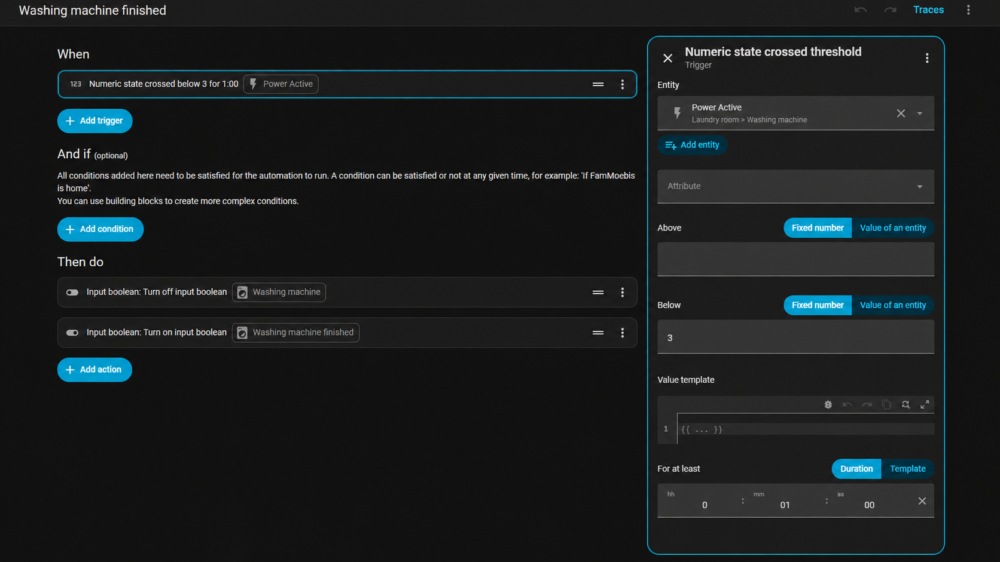
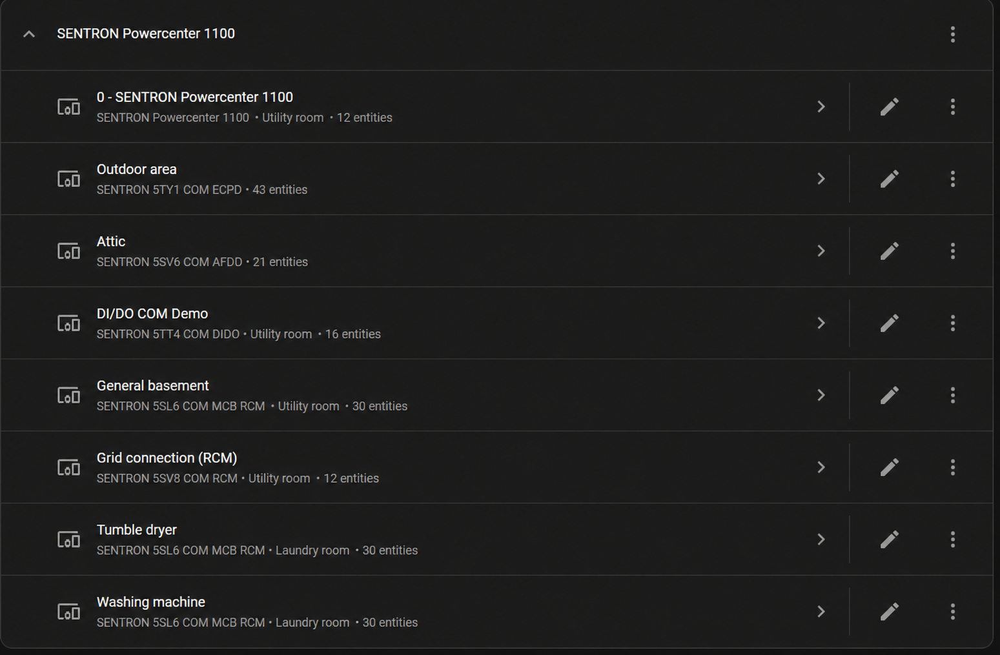
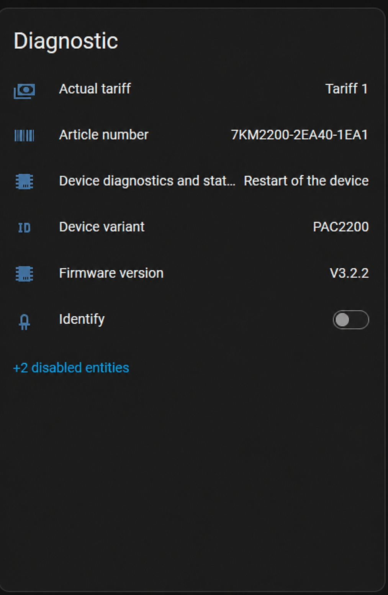
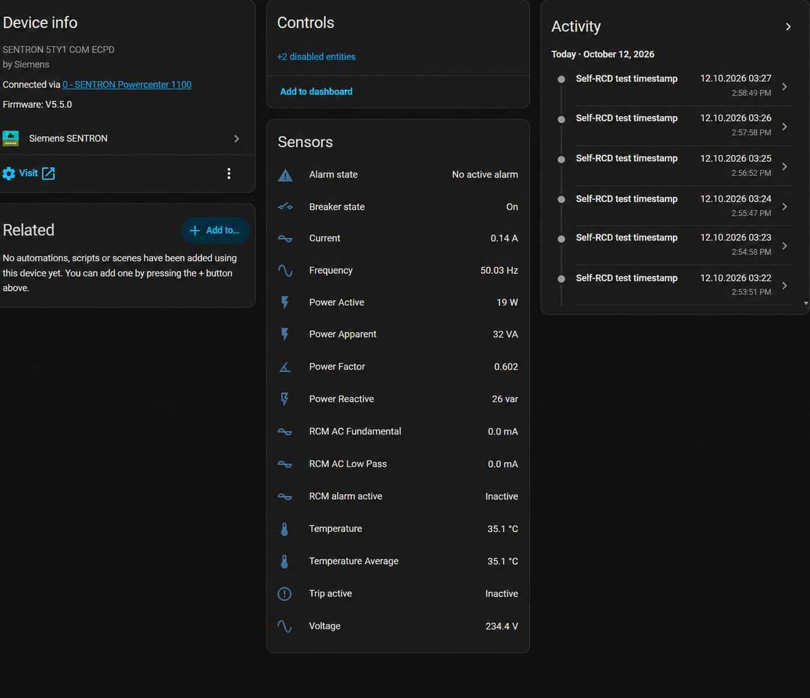
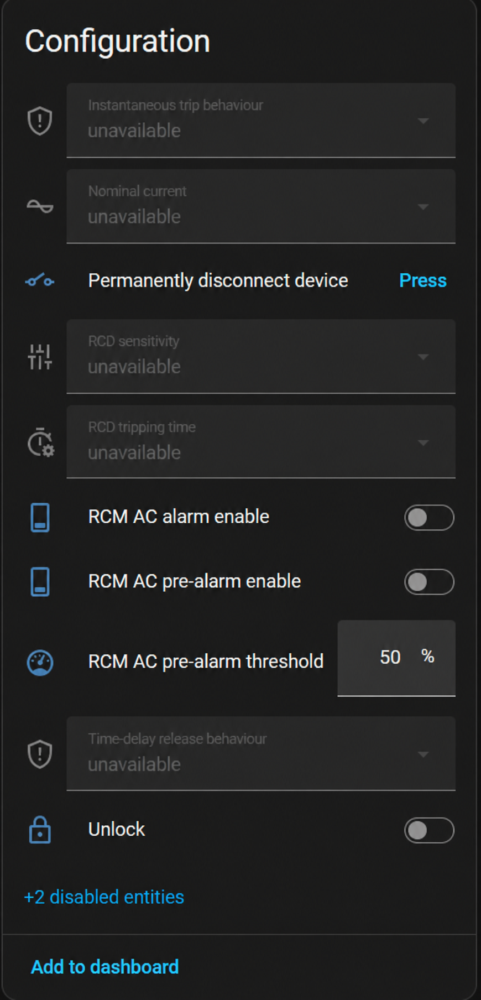
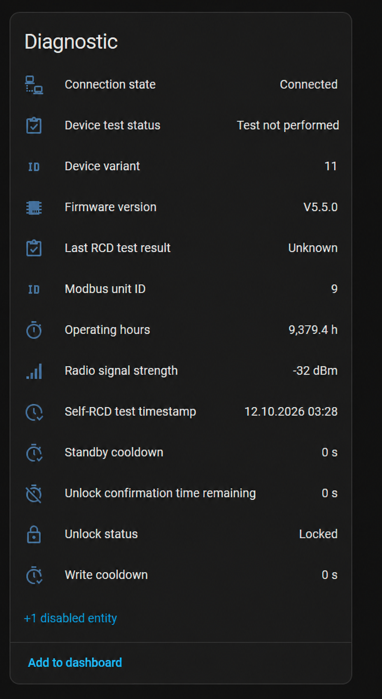

# Screenshot gallery

[Back to the overview](../README.md)

All nine images are the English-edited illustrations approved for this documentation update. They are based on the supplied Home Assistant captures, not live views or screenshots re-captured from the current source revision. Text has been edited for presentation; names, layout, available entities and defaults can differ between releases. No device setting, entity ID, integration translation or automation is changed by these images.

## 1. Electricity, gas and water in one dashboard

Example energy overview combining SENTRON data, external integrations, helpers and cost settings. The integration does not create this dashboard automatically.

## 2. Live power and current power flow

Live power sources and a user-configured hierarchy of monitored areas and loads. “Mohnwinkel” is retained as the installation name.

## 3. Power-based washing-machine completion example

Completion-step example with boolean helpers. Add start detection, a running-state condition and a notification action for the full use case.

## 4. Powercenter 1100 and discovered child devices

Powercenter 1100 and the supported child devices found behind it. Device and area names are user-defined.

## 5. PAC2200 measurements and universal counter

Electrical measurements and the raw Counter Configurable entity. Gas/water use requires a compatible pulse meter plus a separately scaled sensor.

## 6. PAC2200 identification and diagnostics

PAC2200 identification, tariff and device status. These are example readings, not a statement about another installation.

## 7. ECPD circuit measurements and status

ECPD measurements, breaker state and monitoring information. Available entities vary by model, firmware and integration release.

## 8. Device configuration and disabled/unavailable controls

The supplied configuration view retains its disabled and unavailable controls. It is not an instruction to enable every control; permanent disconnection can be irreversible.

## 9. ECPD connection, test and radio diagnostics

Connection state, test results, firmware and radio diagnostics, using the approved English-edited labels.

